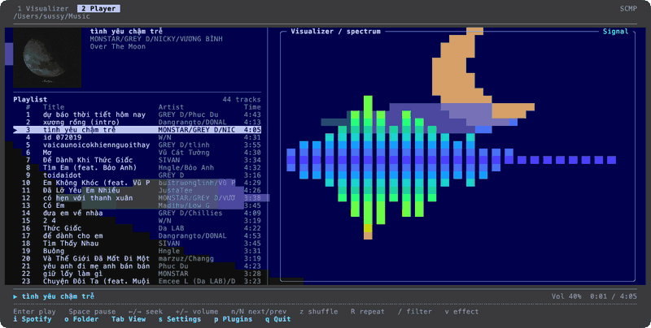
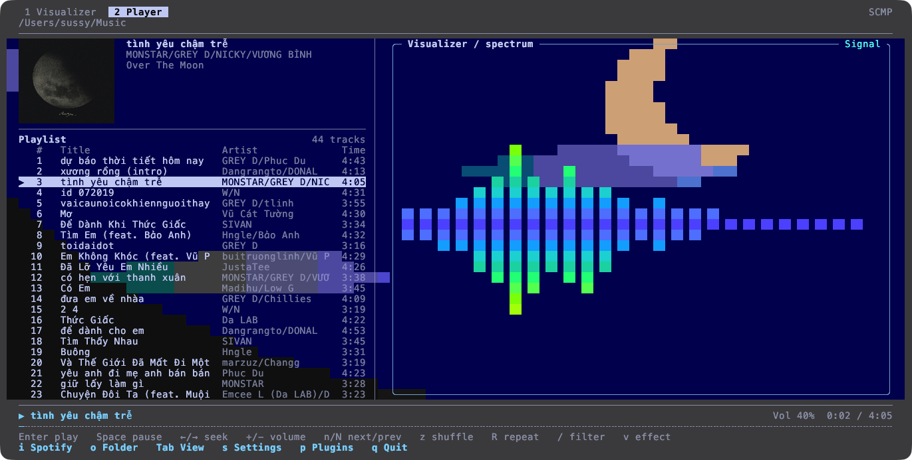
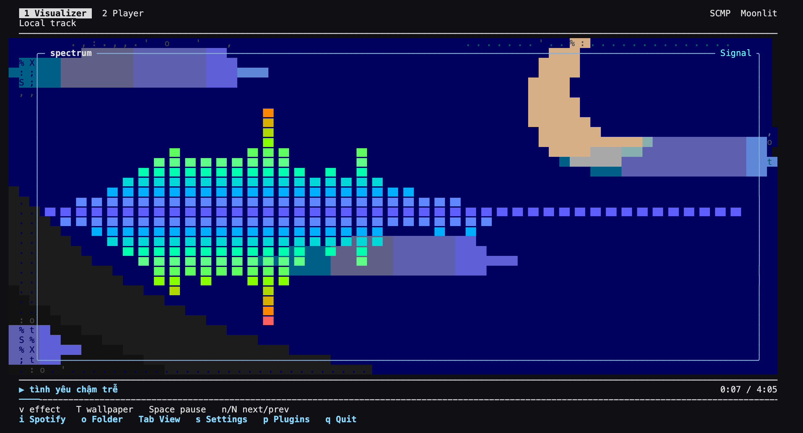
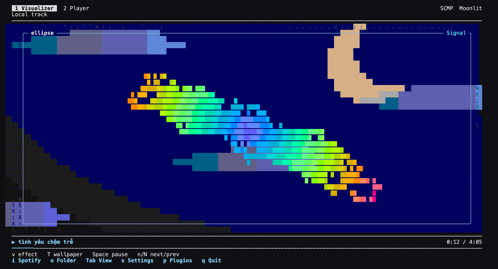
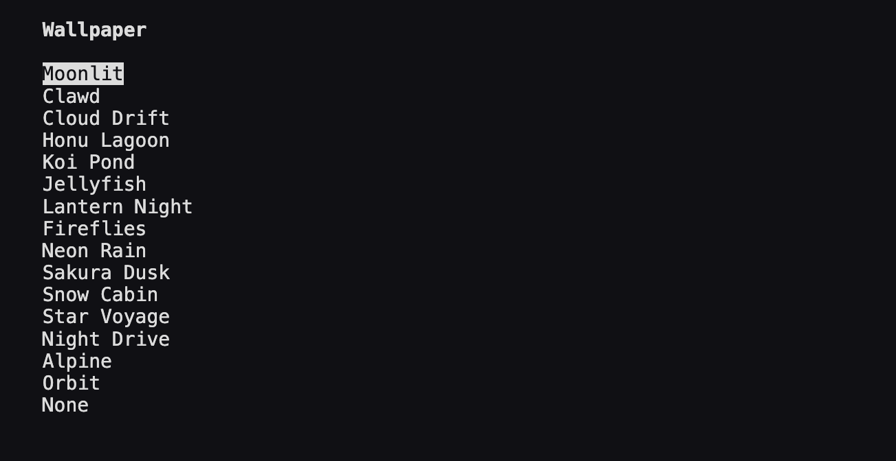
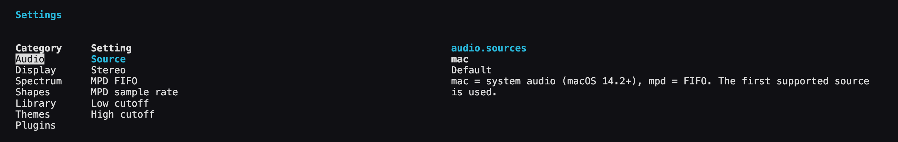

# SCMP - Sussy's CLI Music Player

[](https://github.com/VuxSussy/SCMP/actions/workflows/ci.yml)

SCMP is a terminal music player with a local library, Spotify playlist import, and an audio visualizer. It plays local files on macOS and Linux. On macOS it can also visualize system audio, and on Linux the visualizer can read PCM from MPD.



## Features

- **Player**: browse a local music folder with title, artist and length columns read from tags. Filter, seek, change volume, shuffle, and repeat. Volume and modes are remembered.
- **Cover art**: real images in kitty, Ghostty, iTerm2, WezTerm and sixel terminals, with a character-cell preview elsewhere.
- **Media keys**: on macOS, play/pause, next and previous keys, headphone buttons and the Now Playing widget control SCMP.
- **Visualizer**: spectrum, spectrum circle, ellipse, Lorenz, and lava effects, driven by the playing track, Mac system audio, or MPD.
- **Wallpapers**: animated ASCII and pixel scenes across the whole window, dimmed behind the playlist, or your own image.
- **Spotify import**: download a public playlist into a local folder (macOS).
- **Settings and plugins**: an in-terminal settings editor and native C/C++ plugins.

## Screenshots



| Visualizer: spectrum | Visualizer: ellipse |
| --- | --- |
|  |  |

| Wallpaper picker (`T`) | Settings (`s`) |
| --- | --- |
|  |  |

## Quick start

On macOS, install with Homebrew from this repository:

```sh
brew tap vuxsussy/scmp https://github.com/VuxSussy/SCMP
brew install --HEAD vuxsussy/scmp/scmp
scmp --view player --music "$HOME/Music"
```

Or build from source:

```sh
brew install fftw ncurses
make
./build/scmp --view player --music "$HOME/Music"
```

- [Build and install](#build-and-install)
- [MPD setup](#mpd-setup)
- [Controls](#controls)
- [Local music and pixel themes](#local-music-and-pixel-themes)
- [Spotify playlist import](#spotify-playlist-import)
- [Plugins](#plugins)
- [Configuration](#configuration)

## Build and install

Build with Make, a C++14 compiler, FFTW, and wide-character ncurses. Use a terminal with 256-color support for the full wallpaper palette.

On macOS, install the Xcode Command Line Tools and the Homebrew dependencies.

```sh
xcode-select --install
brew install fftw ncurses
make
./build/scmp
```

On macOS 14.2 or later, SCMP can visualize system audio through a Core Audio tap. Play some audio and grant System Audio Recording when macOS prompts. Manage the grant in **System Settings → Privacy & Security → Screen & System Audio Recording**.

On Linux, install the FFTW and ncurses development packages, then run `make`. For Debian and Ubuntu, the packages are `libfftw3-dev` and `libncurses-dev`. Local playback on Linux also needs FFmpeg (`ffmpeg` and `ffprobe`) and an audio client: `pacat` from PulseAudio or PipeWire, `pw-cat`, or ALSA's `aplay`, tried in that order. Set `SCMP_AUDIO_SINK` to use another command that reads 48 kHz stereo s16le PCM on stdin.

Run `./install.sh` to install both executables in `/usr/local/bin` and seed `~/.scmp/config` and `~/.scmp/colors`. The Spotify command has its own dependencies listed below.

## MPD setup

Add a stereo PCM FIFO to your MPD configuration and select the MPD source in SCMP.

```conf
audio_output {
    type   "fifo"
    name   "SCMP"
    path   "/tmp/mpd.fifo"
    format "44100:16:2"
}
```

```sh
scmp --set audio.sources=mpd
```

If the visualization lags behind playback, try lowering MPD's `audio_buffer_size`.

## Usage

Launch `scmp` after installation, or run `./build/scmp` from the project directory.

Start directly in Lava with `scmp --mode lava`. Move the mouse inside the lava shape to split it and outside to let it rejoin. Arrow keys or `hjkl` move a terminal cursor for the same interaction. Mouse movement requires terminal mouse reporting.

### Controls

| Key | Description |
| --- | ----------- |
| <kbd>1</kbd> / <kbd>2</kbd> | switch to Visualizer / Player |
| <kbd>Tab</kbd> | toggle between Visualizer and Player |
| <kbd>v</kbd> | cycle visualizer effects |
| <kbd>space</kbd> | pause or resume local playback |
| <kbd>←</kbd> / <kbd>→</kbd> | seek 5 seconds back / forward |
| <kbd>+</kbd> / <kbd>-</kbd> | volume up / down |
| <kbd>n</kbd> / <kbd>N</kbd> | next / previous track |
| <kbd>z</kbd> | shuffle on or off |
| <kbd>R</kbd> | repeat off → all → one |
| <kbd>o</kbd> | open a local music folder |
| <kbd>i</kbd> | import a public Spotify playlist and open the downloads in Player (macOS) |
| <kbd>t</kbd> / <kbd>T</kbd> | cycle wallpapers / open the wallpaper picker |
| <kbd>p</kbd> | open the plugin manager |
| <kbd>s</kbd> | open settings |
| <kbd>q</kbd> or <kbd>CTRL-C</kbd>| Quit |

## Local music and pixel themes

Point `scmp` at a directory with downloaded tracks. It scans subfolders and plays files from the playlist through AVFoundation on macOS and through FFmpeg on Linux. The visualizer reads the player's own stereo PCM, so folder playback starts without the System Audio Recording permission. The playlist reads each track's title, artist and length in the background, and the filter also matches titles and artists.

```sh
scmp --view player --music "$HOME/Music/My Albums"
```

`↑`/`↓` or `j`/`k` moves the selection. Enter plays it and Space pauses or resumes. Use `/` to filter by filename or folder, Esc to clear the filter, and `C` to jump to the playing track. The highlight marks your selection and ▶ marks the playing track. Playback advances through the full folder in filename order.

Player shows the selected track’s cover and album details above the playlist when there is room. The bordered visualizer sits to the right in wide terminals and below the playlist in narrower ones. Press `v` to change the effect in either view. Press `1` for the full-screen Visualizer, `2` for the Player, or Tab to switch. Switching views preserves the current track and its position. The Visualizer uses the current local track when one is loaded. Before a local track is loaded, it uses the configured live source, which defaults to Mac system audio on macOS. Press `r` in the Visualizer to reconnect a live source.

With `--music DIR`, the app starts in the Player when that folder has tracks and in the Visualizer when it is empty. Use `--view visualizer` or `--view player` to choose the opening view. Use `n`/`N` for next/previous, `←`/`→` to seek, `+`/`-` for volume, `z` for shuffle, `R` to cycle repeat, and `v` for the next visualizer effect. On macOS, the keyboard media keys, headphone controls and the Now Playing widget in Control Center also control playback. Press `o` in either view to open a folder in the Player.

SCMP remembers the last view, effect, wallpaper choice, folder, filter, selection, playback position and status, volume, shuffle, and repeat when you exit. The session is stored beside the config as `config.session`. Command-line options override the corresponding restored choices.

Album covers appear as inline images in kitty and Ghostty (kitty graphics), iTerm2 and WezTerm (iTerm2 inline images), and foot, mlterm, Konsole and other sixel terminals. Set `SCMP_IMAGE_PROTOCOL` to `kitty`, `iterm`, `sixel` or `none` to override the detection. Inside tmux and screen, and in other terminals, SCMP uses the character-cell preview. The playlist reads the selected track's embedded cover, including MP3, M4A, and FLAC artwork. It also looks for `cover`, `folder`, `front`, and `album` JPEG or PNG files beside the track. A pixel record appears when no cover is found.

On macOS, the wallpaper picker (`T`) includes the 12 animated ASCII scenes from [Claude Desktop Themes](https://github.com/0toshigami/claude-desktop-themes), including Moonlit, Koi Pond, and Sakura Dusk. The wallpaper fills the window and dims slightly behind the playlist so titles stay readable. A border marks the effect area and shows the current mode and signal status. The audio source appears under the Visualizer tab. Press `t` to cycle scenes and use `theme.motion=false` to pause wallpaper animation. The original pixel scenes and local image backgrounds are also available. Use a 256-color terminal for the full palette.

```sh
scmp --view visualizer --theme koi-pond --mode spectrum
scmp --set theme.name=moonlit
scmp --set "theme.background=$HOME/Pictures/pixel-room.png"
scmp --set theme.background=none
```

## Spotify playlist import

On macOS, press `i` in `scmp`, paste a public playlist link and confirm the download folder. Download progress appears in the terminal, then Player opens the downloaded tracks. To retry missing tracks, use the same link and folder again.

Spotify import needs Python 3.8+, `uv`, and FFmpeg. On macOS, install the download tools with `brew install uv ffmpeg deno`. Deno helps yt-dlp process YouTube audio. `uv` runs the pinned spotDL version in an isolated environment. The build and installer place the Spotify helper beside `scmp`.

```sh
./build/scmp spotify import 'https://open.spotify.com/playlist/PLAYLIST_ID' -o "$HOME/Music/My Playlist"
./build/scmp spotify download "$HOME/Music/My Playlist"
./build/scmp --view player --music "$HOME/Music/My Playlist"
```

Import writes `playlist.spotdl` with the track list and metadata. Add `--download` to `import` to fetch audio immediately or resume the same playlist. If you omit `-o`, the playlist goes under `~/Music/Spotify/<playlist-id>`.

spotDL matches the tracks against YouTube, YouTube Music, and SoundCloud. yt-dlp and FFmpeg produce numbered MP3s for the local player. Download only tracks you have permission to save. If a match is missing or incorrect, set that track's `download_url` in `playlist.spotdl` to an authorized source before downloading it.

If some tracks fail, `download` reports how many are ready and exits with a failure status. Rerun it on the same folder to retry missing tracks. Completed files stay in place. Use a new output folder to import a changed playlist.

## Plugins

Press `p` or run `scmp --plugins` to list plugins, check load errors, and enable or disable a plugin with Enter. The manager looks in `~/.scmp/plugins` by default. Set `plugins.directory` to use another folder. Native plugins execute with the same permissions as `scmp`, so only enable plugins you trust.

Build and try the bundled stereo oscilloscope from the repository:

```sh
make example-plugin
./build/scmp --set "plugins.directory=$PWD/build/plugins"
./build/scmp --plugins
```

Select Pulse Grid and press Enter, then return to the visualizer. Use [include/scmp/plugin.h](include/scmp/plugin.h) and [the Pulse Grid example](examples/plugins/pulse-grid.c) to write a plugin in C or C++. Export `scmp_plugin_v1` and provide any combination of `background`, `visualizer`, and `overlay` callbacks. Each callback receives a clipped terminal canvas, stereo samples, the current mode, and playback information. Backgrounds draw after the selected theme, and overlays draw after the visualizer. If multiple plugins replace the visualizer, the first by filename is used.

## Configuration

Run `scmp --settings` to edit without starting audio. The three panes show the category, the setting list, and the selected value. Navigate with the arrow keys or `hjkl`, press Enter to edit and again to stage the change, then press `w` to save. `Ctrl-U` clears the edit field, `Esc` cancels the current edit, and `q` closes the menu without saving. During playback, saving applies the new settings and returns to the visualizer.

To save from a shell, repeat `--set` for each key. Use `-c FILE` to select a different configuration.

```sh
scmp --set visualizer.fps=30 --set visualizers=lava,spectrum,ellipse
```

    #Refresh rate of the visualizers. A really high refresh rate may cause screen tearing. Default is 20.
    visualizer.fps=20

    #Defaults to "/tmp/mpd.fifo"
    mpd.fifo.path

    #If set to false the visualizers will use mono mode instead of stereo. Some visualizers will
    #behave differently when mono is enabled. For example, spectrum show two sets of bars.
    audio.stereo.enabled=false

    #Specifies how often the visualizer will change in seconds. 0 means do not rotate. Default is 0.
    visualizer.rotation.secs=10

    #MPD sample rate and spectrum cutoff frequencies in Hz.
    audio.sampling.frequency=44100
    audio.low.cutoff.frequency=30
    audio.high.cutoff.frequency=22050


    #Controls the mode list and rotation order. Also available: spectrum_circle.
    visualizers=spectrum,ellipse,lorenz,lava


    #Configures what character the spectrum visualizer will use. Specifying a space (e.g " ") means the
    #background will be colored instead of the character. Defaults to " ".
    visualizer.spectrum.character=#

    #Spectrum bar width. Defaults to 1.
    visualizer.spectrum.bar.width=2

    #The amount of space between each bar in the spectrum visualizer. Defaults to 1. It's possible to set this to
    #zero to have no space between bars
    visualizer.spectrum.bar.spacing=1

    #Available smoothing options are monstercat, sgs, none.
    visualizer.spectrum.smoothing.mode=monstercat

    #This configures the falloff effect on the spectrum visualizer. Available falloff options are fill,top,none.
    #Defaults to "fill"
    visualizer.spectrum.falloff.mode=fill

    #Configures how fast the falloff character falls. This is an exponential falloff so values usually look
    #best 0.9+ and small changes in this value can have a large effect. Defaults to 0.99
    visualizer.spectrum.falloff.weight=0.99

    #This configures the sgs smoothing effect on the spectrum visualizer. More points spreads out the smoothing
    #effect and increasing passes runs the smoother multiple times on reach run. Defaults are points=3 and passes=1
    visualizer.sgs.smoothing.points=3
    visualizer.sgs.smoothing.passes=1


    #Configures what character the ellipse visualizer will use. Specifying a space (e.g " ") means the
    #background will be colored instead of the character. Defaults to " ".
    visualizer.ellipse.character=#

    #The radius of each color ring in the ellipse visualizer. Defaults to 2.
    visualizer.ellipse.radius=2

    #Specifies the color scheme. The color scheme must be in ~/.scmp/colors/ directory. Default is "colors"
    colors.scheme=rainbow

## License

SCMP is distributed under the MIT License. See [LICENSE](LICENSE) for the copyright and permission notice and [the bundled wallpaper license](vendor/claude-desktop-themes/LICENSE) for the wallpaper assets.
